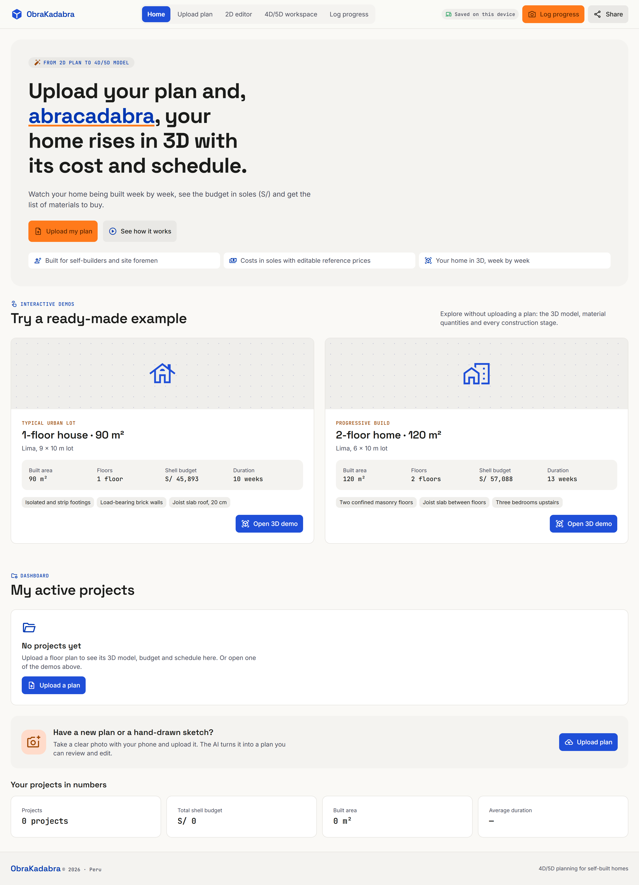
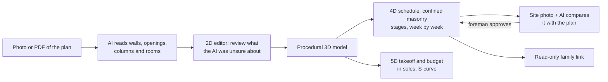
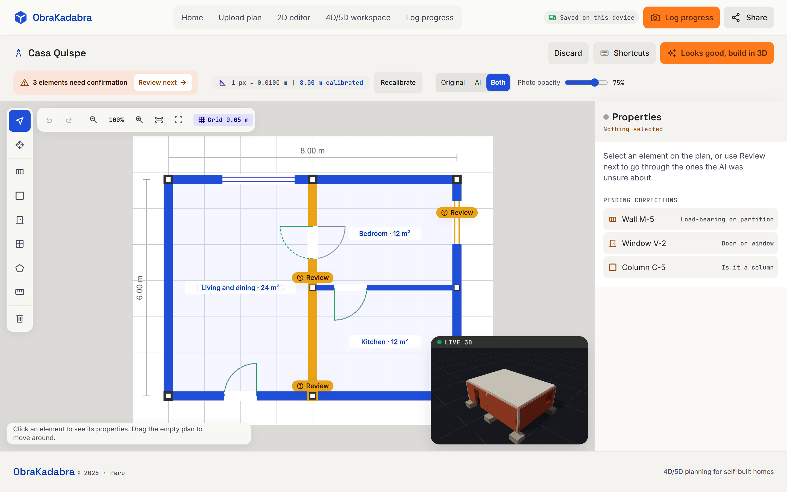
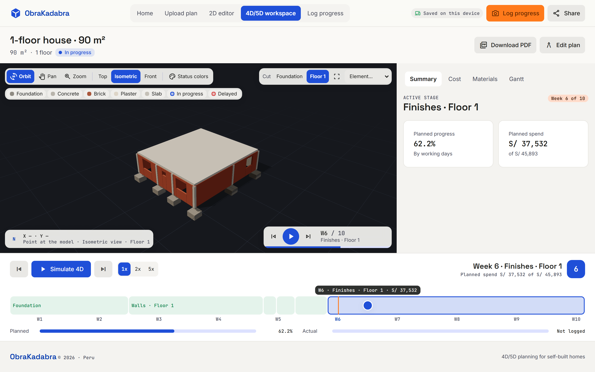
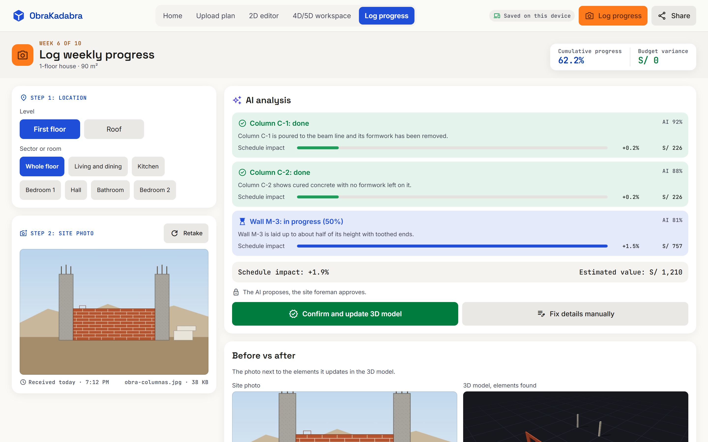
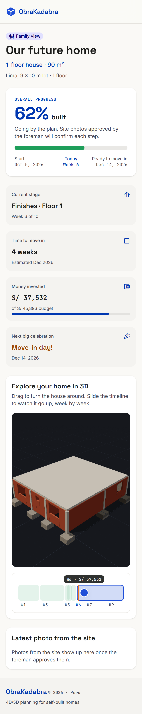

# ObraKadabra

**Upload a photo of your floor plan and, abracadabra, watch your home being built week by week, with its budget.**

Most homes in Peru are self-built: families, foremen (*maestros de obra*) and small contractors build floor by floor without a schedule, a takeoff or a budget they can follow. ObraKadabra turns a phone photo of a 2D plan into a 3D model linked to a construction schedule (4D) and a cost plan (5D), checks real progress from site photos with AI, and gives the family a simple link to follow the build.

| Live demo | Video |
|---|---|
| Pending | Pending |



## How it works



1. **Upload** a straight photo or PDF of the plan and mark one known length to set the scale. A blurry photo gets a warning before it reaches the AI.
2. **The AI reads the plan** (Gemini vision with structured JSON output) and returns every wall, door, window, column and room with a confidence score. The answer is validated with Zod and retried once with the validation errors as feedback.
3. **Review in the 2D editor**: elements the AI was unsure about are flagged, and walls, openings and columns can be drawn, moved and resized with snapping and undo.
4. **Build in 3D**: the same `FloorPlan` drives a procedural React Three Fiber model and the demo models.
5. **4D and 5D**: the schedule follows the order Peruvian confined-masonry homes are built (foundation → walls → columns → beams and slab → roof → finishes), with durations from takeoff ÷ crew yield. Move the slider to see the house, the spend, the S-curve and the materials to buy that week, and send the shopping list to the hardware store on WhatsApp or download it as a PDF.
6. **Log real progress**: a site photo is compared with the elements planned for that week; the foreman corrects and approves the findings, and the 3D model is painted with what was really built.
7. **Share**: a read-only link for the family shows overall progress, the time to move in, the money invested, the next "roofing day" and the 3D home with its timeline.

| 2D editor | 4D/5D workspace |
|---|---|
|  |  |

| Progress from a site photo | Family view (phone) |
|---|---|
|  |  |

More screens, on desktop and mobile, are in [`docs/capturas/`](docs/capturas/), along with a walkthrough video, [`recorrido-desktop.webm`](docs/capturas/recorrido-desktop.webm).

## How we built it

- **One contract, `FloorPlan`.** The AI produces it, the editor edits it, and the viewer, the schedule and the budget consume it. Demos and uploaded plans go through the same pipeline and the same viewer.
- **Pure domain code with tests.** Geometry, takeoff, schedule, earned value and progress live in `src/lib` as pure functions with Vitest tests. Components only render, and hooks only connect.
- **AI behind one door.** `src/lib/ai` is the only code that calls a model. Every answer is validated with Zod, and the model can be swapped with `AI_MODEL` (Gemini, OpenAI, or `fixture` for offline demos and tests).
- **Persistence behind one interface.** `ProjectRepository` has a localStorage version and a Supabase version, and both pass the same contract test suite. Supabase uses anonymous sessions, so nobody has to register; row level security limits every row to its owner, and the only public read is a share-token function.
- **Tested like a product.** Playwright runs every phase's specs on desktop and mobile against a production build. 3D state is exposed as `data-*` attributes instead of being inspected through pixels, the AI is always mocked in end-to-end tests, and axe checks every route.
- **Design.** Screens were designed in Google Stitch and rebuilt with Tailwind tokens and our own components, with WCAG 2.2 AA contrast, keyboard support, 44 px touch targets and reduced-motion fallbacks.

```
src/
├── app/            routes only: they compose features
├── features/       upload, plan-editor, viewer-3d, schedule, budget, progress, workspace, share, share-link, home
├── lib/            ai, geometry, takeoff, schedule, plan, projects, supabase (pure logic and adapters)
├── schemas/        Zod schemas, the single source of the types
├── data/           yields, prices, demos
└── components/     UI primitives and layout
supabase/migrations/  tables, RLS policies, share function and storage bucket
e2e/                  Playwright specs per phase, fixtures and the screenshot script
```

## Challenges

- **Reading real plans.** Phone photos come skewed, blurry and full of dimension lines. We added cropping, rotation, contrast, a scale calibration step and a blur check, cleaned the AI geometry (closing corners, merging collinear walls) and let the user confirm only the uncertain elements.
- **A schedule that matches how Peru builds.** Confined masonry raises the walls first and pours the columns against them, floor by floor. The schedule and the 3D colors follow that order, not a generic Gantt.
- **Honest progress.** The AI proposes and the foreman approves. Only approved logs count, and the family view says "going by the plan" instead of "on track" until a photo confirms it.
- **Fast on a mid-range phone.** The 3D viewer, the Supabase SDK, the PDF library and the share dialog load only when they are used.

## What we learned

- Validating AI output with the same schema as the app makes errors recoverable: one retry with the validation feedback fixes most bad answers.
- A single contract test suite for two storage backends caught real differences (offset timestamps and a race that could create two anonymous users).
- Exposing 3D state as attributes made a WebGL app testable end to end on desktop and mobile.

## What's next

- Measure the AI against a set of real hand-drawn and printed plans, and tune the prompts per plan style.
- Stairs, beams and roof slopes in the takeoff, plus regional price lists.
- Offline-first progress logging for sites without signal.
- An account page to manage shared links and invite the foreman.

## Built with

- **App:** Next.js 16 (App Router, Cache Components), React 19, TypeScript, Tailwind CSS 4
- **3D:** React Three Fiber, drei, three.js
- **State and validation:** Zustand, Zod
- **Data:** Supabase (Postgres with RLS, anonymous auth, Storage); localStorage and IndexedDB without it
- **Files:** pdf.js (plan PDFs), jsPDF (reports)
- **Quality:** Vitest, Playwright, axe-core, Lighthouse
- **Deploy:** Vercel (pending)

### AI tools

- **Gemini 3.5 Flash** (vision, structured JSON output): reads plan photos and compares site photos with the plan. GPT vision models are supported through the same interface.
- **Claude Code** (Anthropic): pair-programmed the app phase by phase, following the rules in `AGENTS.md`.
- **Google Stitch**: generated the screen designs and the design tokens the UI is built from.

## Run it locally

Requirements: Node 24 and pnpm 11.

```bash
pnpm install
cp .env.example .env.local
```

To try everything **without an API key**, set `AI_MODEL=fixture` in `.env.local`. The AI routes then answer from the recorded fixtures in `e2e/fixtures/`, so uploading `e2e/fixtures/plano-simple.png` and logging progress with `e2e/fixtures/obra-columnas.jpg` work end to end.

```bash
pnpm dev                 # http://localhost:3000
```

With the Supabase variables empty, projects stay in the browser (localStorage and IndexedDB). The two demos always work, with no keys and no sign-in.

```bash
pnpm check               # lint + typecheck + unit tests + Playwright (desktop and mobile)
pnpm capturas            # regenerate docs/capturas (screenshots and walkthrough video)
pnpm build && pnpm start --port 3100
pnpm lighthouse          # Lighthouse on the running local build
```

### Environment variables

| Variable | Where | Purpose |
|---|---|---|
| `AI_API_KEY` | server | Gemini or OpenAI key for reading plans and site photos |
| `AI_MODEL` | server | `gemini-*` (default `gemini-3.5-flash`), `gpt-*` or `fixture` (no key) |
| `NEXT_PUBLIC_SUPABASE_URL` | browser | `https://<ref>.supabase.co`; empty keeps projects in the browser |
| `NEXT_PUBLIC_SUPABASE_PUBLISHABLE_KEY` | browser | `sb_publishable_…` key (row level security protects the data) |
| `SUPABASE_SECRET_KEY` | server | `sb_secret_…`; only signs photo URLs for the family view |
| `NEXT_PUBLIC_SITE_URL` | optional | Base URL of share links and Open Graph tags |
| `SUPABASE_ACCESS_TOKEN`, `SUPABASE_PROJECT_REF` | your machine | Supabase CLI for migrations |

### Supabase (optional)

1. Create a project and copy the URL, the publishable key and the secret key.
2. Run `supabase/migrations/20261115120000_projects_progress_photos.sql` in the SQL Editor (it is safe to run more than once), or `npx supabase db push`.
3. Authentication → Sign In / Providers → turn on **Allow anonymous sign-ins**.

## Developed during IceHacks

All the code in this repository was written during the hackathon. The first commit is from **November 14, 2026**, and the work was merged phase by phase through pull requests (setup, domain and home, 3D viewer, schedule and budget, plan upload with AI, 2D editor, progress from photos, persistence and sharing, polish). The full history is in the [merged pull requests](https://github.com/SteveArms/ObraKadabra/pulls?q=is%3Apr+is%3Amerged) and the [commit log](https://github.com/SteveArms/ObraKadabra/commits/main).
